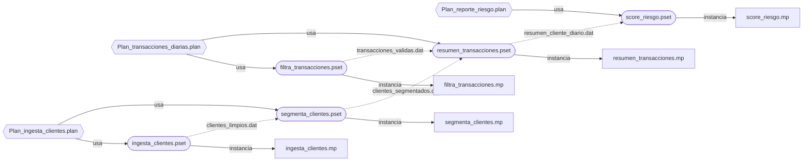

# Mapa de relaciones Ab Initio

Carpeta: `/Users/benjamingarcia/sam/bnxconvertidor/abinitio/ejercicio_3_planes`

Archivos: dml=6, graph=5, ksh=2, plan=3, pset=5, xfr=6

## Psets y lo que instancian

| Pset | Instancia | Estado | Parametros |
|---|---|---|---|
| filtra_transacciones.pset | filtra_transacciones.mp | presente | 4 |
| ingesta_clientes.pset | ingesta_clientes.mp | presente | 3 |
| resumen_transacciones.pset | resumen_transacciones.mp | presente | 4 |
| score_riesgo.pset | score_riesgo.mp | presente | 4 |
| segmenta_clientes.pset | segmenta_clientes.mp | presente | 4 |

## Grafos/planes y quien los instancia

- `Plan_ingesta_clientes.plan` [XXGplan]: sin pset
- `Plan_reporte_riesgo.plan` [XXGplan]: sin pset
- `Plan_transacciones_diarias.plan` [XXGplan]: sin pset
- `filtra_transacciones.mp` [XXGgraph]: `filtra_transacciones.pset`
- `ingesta_clientes.mp` [XXGgraph]: `ingesta_clientes.pset`
- `resumen_transacciones.mp` [XXGgraph]: `resumen_transacciones.pset`
- `score_riesgo.mp` [XXGgraph]: `score_riesgo.pset`
- `segmenta_clientes.mp` [XXGgraph]: `segmenta_clientes.pset`

## Tareas y orden de los planes

### Plan_ingesta_clientes.plan

- Prepara_directorios (id 2)  -> `prepara_directorios.ksh`
- Run_ingesta_clientes (id 3)  -> `ingesta_clientes.pset`
- Run_segmenta_clientes (id 4)  -> `segmenta_clientes.pset`

Relaciones task_prior_task tal cual vienen en el archivo (a -> b). El sentido exacto (cual corre primero) NO esta verificado contra Ab Initio:

- Run_ingesta_clientes (id 3) -> Prepara_directorios (id 2) [flag 0]
- Run_segmenta_clientes (id 4) -> Run_ingesta_clientes (id 3) [flag 0]

### Plan_reporte_riesgo.plan

- Run_score_riesgo (id 2)  -> `score_riesgo.pset`
- Notifica_reporte (id 3)  -> `notifica_reporte.ksh`

Relaciones task_prior_task tal cual vienen en el archivo (a -> b). El sentido exacto (cual corre primero) NO esta verificado contra Ab Initio:

- Notifica_reporte (id 3) -> Run_score_riesgo (id 2) [flag 0]

### Plan_transacciones_diarias.plan

- Run_filtra_transacciones (id 2)  -> `filtra_transacciones.pset`
- Run_resumen_transacciones (id 3)  -> `resumen_transacciones.pset`
- Log_estado_ok (id 4)

Relaciones task_prior_task tal cual vienen en el archivo (a -> b). El sentido exacto (cual corre primero) NO esta verificado contra Ab Initio:

- Run_resumen_transacciones (id 3) -> Run_filtra_transacciones (id 2) [flag 0]
- Log_estado_ok (id 4) -> Run_resumen_transacciones (id 3) [flag 0]

## Flujo de datos entre psets

- `filtra_transacciones.pset` -> `resumen_transacciones.pset` (transacciones_validas.dat)
- `ingesta_clientes.pset` -> `segmenta_clientes.pset` (clientes_limpios.dat)
- `resumen_transacciones.pset` -> `score_riesgo.pset` (resumen_cliente_diario.dat)
- `segmenta_clientes.pset` -> `resumen_transacciones.pset` (clientes_segmentados.dat)

## Faltantes (referenciados, no estan en la carpeta)

- ninguno

## Soporte faltante (xfr/dml/dbc)

- ninguno

## Diagrama

